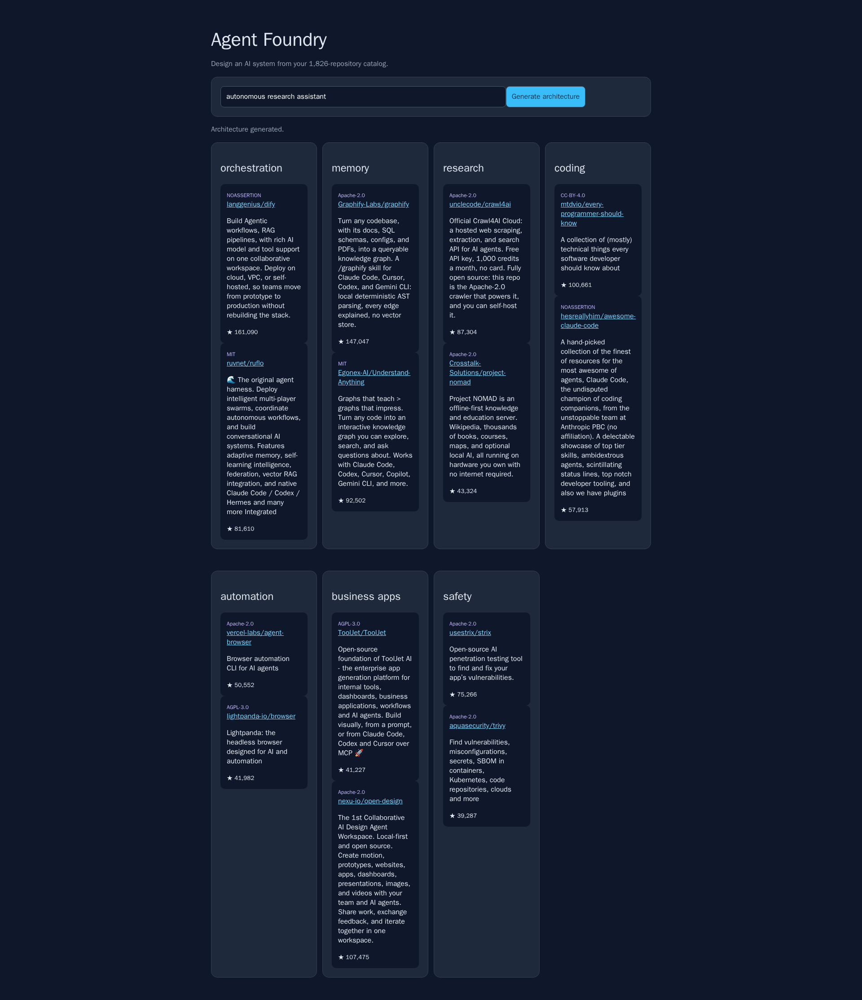

# GitHub-Repos-

For AI research and agent architecture discovery.

## Preview



## Agent Architecture Builder

Generate a proposed stack from the catalog without API keys or external services:

```bash
python agent_architect.py "autonomous research assistant"
python agent_architect.py "coding agency" --per-capability 3
```

Start the backend API:

```bash
python agent_api.py
open http://127.0.0.1:8787
curl http://127.0.0.1:8787/health
curl 'http://127.0.0.1:8787/api/repositories?q=agent%20memory&limit=5'
curl -X POST http://127.0.0.1:8787/api/architecture \
  -H 'Content-Type: application/json' \
  -d '{"product":"autonomous research assistant","per_capability":2}'
```

The tool searches the catalog across orchestration, memory, research, coding,
automation, business apps, and safety. It de-duplicates repositories and includes
license metadata where available. Recommendations are starting points; review
licenses, maintenance, dependencies, and security before using code in a product.

Run the focused tests with:

```bash
python -m unittest test_agent_architect.py
```
